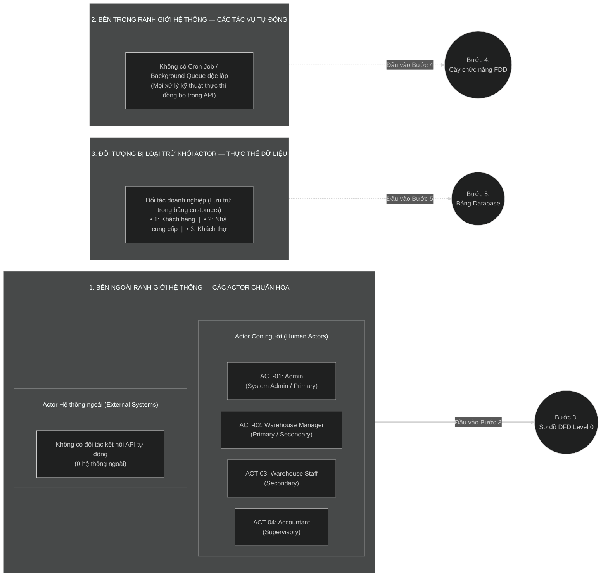

# BƯỚC 2: TRUY VẾT & BÓC TÁCH TÁC NHÂN (7 CÂU HỎI TRUY VẾT ACTOR)

> **Nguồn đầu vào:** [Bước 1 — Khảo sát & Hiểu bài toán (`md/analysis/1-problem-survey.md`)](./1-problem-survey.md)  
> **Quy chuẩn áp dụng:** [`2_actor_identification_7_questions.md`](../../.agents/rules/2-analysis/2_actor_identification_7_questions.md)

---

## 1. Nguyên tắc Định nghĩa Actor

- **Actor (Tác nhân)** là bất kỳ thực thể nào **nằm ngoài ranh giới hệ thống (System Boundary)** có tương tác trực tiếp (gửi dữ liệu `Input` hoặc nhận kết quả `Output`) với hệ thống qua giao diện hoặc RESTful API.
- Actor đại diện cho **Vai trò (Role)** gắn với tập quyền hạn (RBAC) và phạm vi dữ liệu (`Scope`) trong hệ thống, không phải chức danh hành chính ngoài đời hay một cá nhân cụ thể.

---

## 2. Bảy Câu hỏi Truy vết Actor (Ánh xạ trực tiếp từ Bước 1)

| Thứ tự | Câu hỏi truy vết Actor | Nguồn dữ liệu từ Bước 1 (`1-problem-survey.md`) | Phân tích & Kết quả nhận diện |
|:---:|---|---|---|
| **Câu 1** | **Ai trực tiếp đưa dữ liệu mới vào hệ thống?** *(Primary Actor)* | • **Câu 2** (Quy trình hiện tại) • **Câu 4** (Ai sử dụng) • **Mục 7** (`QĐ-01`..`QĐ-06`) | • **`Admin`:** Khởi tạo và cấu hình quyền cho vai trò (`roles`), tạo tài khoản nhân viên (`employees`), gán nhân viên phụ trách kho cho mọi kho; tạo mới Kho hàng (`warehouses`), Danh mục sản phẩm đa cấp (`categories`), Đơn vị tính (`units`), Sản phẩm kèm `SKU`/`Barcode` (`products`) và Đối tác (`customers`). • **`Warehouse Manager`:** Gán/hủy gán nhân viên phụ trách kho đối với chính các kho (`warehouses`) mà mình đang quản lý; tạo mới và cập nhật Danh mục sản phẩm (`categories`), Đơn vị tính (`units`), Sản phẩm kèm `SKU`/`Barcode` (`products`) và Đối tác (`customers`: Khách hàng, Nhà cung cấp, Khách thợ). |
| **Câu 2** | **Ai tiếp nhận, duyệt hoặc xử lý bước tiếp theo?** *(Secondary Actor)* | • **Câu 3** (Vấn đề quy trình) • **Câu 4** (Ai sử dụng) • **Mục 7** (`QĐ-03`, `QĐ-05`) | • **`Warehouse Manager`:** Tiếp nhận kho hàng được `Admin` phân công quản lý, sau đó trực tiếp phân bổ (gán/hủy gán) nhân viên kho (`Warehouse Staff`) vào kho của mình và duy trì bộ danh mục hàng hóa/đối tác. • **`Warehouse Staff`:** Tiếp nhận tài khoản và phạm vi kho được gán (`warehouse_ids`); đăng nhập để tra cứu danh mục sản phẩm, quét/tìm kiếm theo mã `SKU`/`Barcode`, tra cứu đơn vị tính và đối tác phục vụ tác nghiệp tại kho. |
| **Câu 3** | **Ai xem báo cáo, giám sát và ra quyết định?** *(Supervisory Actor)* | • **Câu 4** (Ai sử dụng) • **Câu 5** (Kết quả mong muốn) | • **`Accountant` (Kế toán):** Đăng nhập hệ thống để tra cứu, đối soát toàn bộ danh mục kho hàng, danh mục sản phẩm, đơn vị tính, sản phẩm (giá, `SKU`, `Barcode`) và danh sách đối tác (`Khách hàng`, `Nhà cung cấp`, `Khách thợ`) phục vụ kiểm toán và lập báo cáo. • **`Admin` & `Warehouse Manager`:** Giám sát danh sách nhân sự, trạng thái hoạt động của các kho và toàn bộ dữ liệu nền tảng. |
| **Câu 4** | **Khách hàng / Người dùng cuối tương tác trực tiếp hay gián tiếp?** *(Self-service User vs Data Entity)* | • **Câu 1** (Ranh giới hệ thống) • **Câu 2 & Câu 4** • **Mục 7** (`QĐ-02`) | • **Khách hàng (`type = 1`)**, **Nhà cung cấp (`type = 2`)** và **Khách thợ (`type = 3`)** **KHÔNG** có tài khoản đăng nhập và không tự thao tác trực tiếp trên hệ thống. • Mọi thông tin của 3 nhóm đối tác này đều do `Admin` và `Warehouse Manager` nhập hộ vào hệ thống. • ➔ **Kết luận:** Loại khỏi danh sách Actor; chuyển hóa thành **Thực thể dữ liệu (`Entity` — Collection `customers`)** ở Bước 5. |
| **Câu 5** | **Hệ thống có trao đổi dữ liệu tự động với bên thứ 3 nào không?** *(External System Actor)* | • **Câu 1** (Ranh giới hệ thống) • **Câu 5** (Kết quả mong muốn) | • Trong phạm vi `Module 01` và `Module 02`, hệ thống không kết nối tự động hai chiều với bất kỳ API bên thứ 3 nào. • Thiết bị đầu đọc mã vạch (`Barcode Scanner`) tại kho chỉ đóng vai trò thiết bị nhập liệu đầu cuối (HID/Keyboard) gửi chuỗi ký tự `barcode` qua request của người dùng. • ➔ **Kết luận:** **Không có Actor Hệ thống ngoài**. |
| **Câu 6** | **Có nghiệp vụ nào tự động chạy ngầm theo thời gian/hàng đợi không?** *(Automated Process / Background Job)* | • **Câu 3** (Mục tiêu hệ thống) • **Câu 5** (Tiêu chí nghiệm thu) | • Trong phạm vi `Module 01` (Auth, Users, RBAC) và `Module 02` (Dữ liệu nền tảng), toàn bộ các xử lý kỹ thuật gồm: mã hóa `sha512` (`password`, `refresh_token`), thu hồi `refresh_tokens` khi khóa tài khoản/đổi mật khẩu, và tự động sinh chuỗi tìm kiếm `unsign_search` đều được thực thi **đồng bộ (synchronous)** ngay trong luồng xử lý của `Service` khi nhận HTTP Request. • ➔ **Kết luận:** **Không có Tác vụ tự động chạy ngầm (Cron Job / Queue)** tách riêng. |
| **Câu 7** | **Ai quản trị tài khoản, phân quyền và cấu hình nền tảng?** *(System Admin)* | • **Câu 4** (Ai sử dụng) • **Mục 7** (`QĐ-03`, `QĐ-06`) | • **`Admin` (Quản trị viên hệ thống):** Nắm toàn quyền quản trị tài khoản nhân viên (`employees`), quản lý vai trò & cập nhật mảng quyền RBAC (`roles.permissions`), gán kho phụ trách trên toàn hệ thống, cấu hình danh mục Kho hàng (`warehouses`) và thực hiện xóa cứng (`DELETE`) các danh mục gốc khi chưa có dữ liệu tham chiếu. |

---

## 3. Kiểm tra theo 4 Quy tắc Chuẩn hóa & Loại trừ Sai lầm

1. **Quy tắc 1 — Gộp chức danh trùng quyền:**
   - Hệ thống giữ đúng 4 vai trò độc lập (`Admin`, `Warehouse Manager`, `Warehouse Staff`, `Accountant`) vì mỗi vai trò có tập quyền hạn RBAC và phạm vi (`Scope`) khác biệt rõ rệt (`Warehouse Staff` gắn với phạm vi kho được gán `warehouse_ids`, còn `Accountant` tra cứu toàn hệ thống để đối soát/lên báo cáo).
2. **Quy tắc 2 — Phân biệt Actor vs Data Entity:**
   - Loại bỏ **Khách hàng (`type = 1`)**, **Nhà cung cấp (`type = 2`)** và **Khách thợ (`type = 3`)** khỏi danh sách Actor vì họ không trực tiếp gọi API hay đăng nhập hệ thống. Ba đối tượng này được hợp nhất vào duy nhất 1 bảng dữ liệu **`customers`** ở Bước 5 (`QĐ-02`).
3. **Quy tắc 3 — Loại bỏ Hệ thống ngoài giả định:**
   - Không đưa Excel hay máy quét Barcode thành Actor hệ thống ngoài vì không có giao thức tích hợp API hai chiều tự động.
4. **Quy tắc 4 — Tách bạch Tác vụ tự động (Cron Job / Queue):**
   - Mọi xử lý ngầm (`unsign_search`, `sha512`, thu hồi token) nằm gọn bên trong luồng đồng bộ của từng API nên số lượng Cron Job / Background Queue độc lập bằng `0`.

---

## 4. Kết quả Đầu ra Chuẩn hóa (Đầu vào cho Bước 3, Bước 4 & Bước 5)

### 4.1. Bảng 1 — Danh sách Actor Chuẩn hóa (Con người & Hệ thống ngoài)

| STT | Mã Actor | Tên Actor (Vai trò) | Phân loại Actor | Tiền tố Mã Hành động (Bước 3) | Mô tả phạm vi tương tác chính trên Hệ thống (Module 01 & Module 02) |
|:---:|---|---|---|---:|---|
| **1** | `ACT-01` | **Admin** *(Quản trị viên hệ thống)* | Con người (`System Admin` / `Primary`) | `[Admin - XX]` | • Đăng nhập, đăng xuất, làm mới token, đổi mật khẩu cá nhân. • Quản lý vai trò & cập nhật phân quyền RBAC (`roles`). • Quản lý tài khoản nhân viên (`employees`), khóa/mở khóa, đặt lại mật khẩu, đổi vai trò. • Gán/hủy gán nhân viên phụ trách kho (`warehouse_ids`) cho bất kỳ kho nào trên toàn hệ thống. • Toàn quyền CRUD (`read`, `write`, `delete`) trên Kho hàng (`warehouses`), Danh mục SP đa cấp (`categories`), Đơn vị tính (`units`), Sản phẩm & `SKU`/`Barcode` (`products`), Đối tác (`customers`: Khách hàng, Nhà cung cấp, Khách thợ). |
| **2** | `ACT-02` | **Warehouse Manager** *(Quản lý kho)* | Con người (`Primary` / `Secondary`) | `[Quản lý kho - XX]` | • Đăng nhập, đăng xuất, làm mới token, đổi mật khẩu cá nhân. • Xem danh sách kho và nhân viên thuộc phạm vi kho mình quản lý. • **Gán / hủy gán nhân viên phụ trách kho đối với chính các Kho (`Warehouse`) mà mình đang quản lý** (`ScopeGuard`). • Xem và thêm mới / cập nhật (`read`, `write`) Danh mục SP (`categories`), Đơn vị tính (`units`), Sản phẩm & mã `SKU`/`Barcode` (`products`), Đối tác (`customers`: Khách hàng, Nhà cung cấp, Khách thợ). |
| **3** | `ACT-03` | **Warehouse Staff** *(Nhân viên kho)* | Con người (`Secondary`) | `[Nhân viên kho - XX]` | • Đăng nhập, đăng xuất, làm mới token, đổi mật khẩu cá nhân. • Xem thông tin các kho hàng mà mình được gán phụ trách (`warehouse_ids`). • Tra cứu (`read`) Danh mục SP, Đơn vị tính, Sản phẩm, quét/tra cứu nhanh theo mã `SKU`/`Barcode` và tra cứu thông tin Đối tác (`customers`). |
| **4** | `ACT-04` | **Accountant** *(Kế toán)* | Con người (`Supervisory`) | `[Kế toán - XX]` | • Đăng nhập, đăng xuất, làm mới token, đổi mật khẩu cá nhân. • Tra cứu (`read`) toàn bộ Kho hàng, Danh mục SP, Đơn vị tính, Sản phẩm (giá, `SKU`, `Barcode`) và Đối tác (`customers`: Khách hàng, Nhà cung cấp, Khách thợ) trên toàn hệ thống để đối soát và tổng hợp báo cáo. |

> *(Ghi chú: Số lượng Actor Hệ thống ngoài = `0`).*

---

### 4.2. Bảng 2 — Danh sách Tác vụ Tự động Chạy ngầm (Cron Job / Background Queue)

| STT | Mã Tác vụ | Tên Tác vụ Tự động | Cơ chế kích hoạt | Mô tả xử lý |
|:---:|:---:|---|---|---|
| — | *Không có* | *Không phát sinh Cron Job / Background Queue độc lập trong phạm vi Module 01 & Module 02* | Đồng bộ trong Service khi gọi API | Các xử lý kỹ thuật (băm `sha512` cho mật khẩu/refresh token, thu hồi toàn bộ `refresh_tokens` khi khóa tài khoản hoặc đổi mật khẩu, tự sinh trường tìm kiếm tiếng Việt `unsign_search`) được thực thi đồng bộ ngay bên trong từng API tương ứng. |

> **Tổng số Tác vụ tự động (Bước 2) = `0`** *(Dùng để kiểm chứng công thức bảo toàn Chức năng Cấp 2 ở Bước 4)*.

---

### 4.3. Sơ đồ Phân loại Actor & Ranh giới Hệ thống (Actor Boundary & Classification Diagram)

