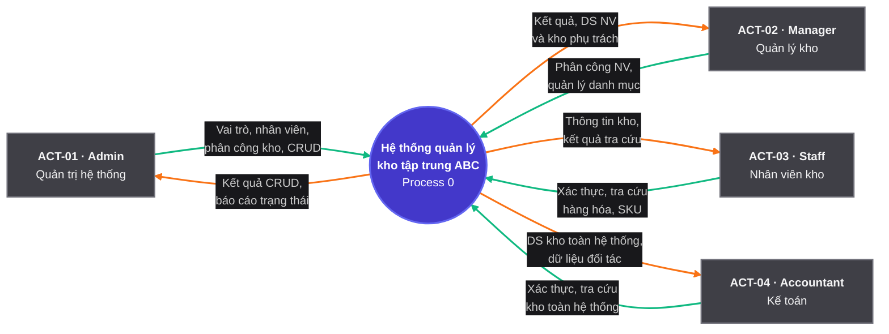

# BƯỚC 3: THIẾT KẾ SƠ ĐỒ NGỮ CẢNH (DFD LEVEL 0 — CONTEXT DIAGRAM)

> **Nguồn đầu vào:**
> - [Bước 1 — Khảo sát & Hiểu bài toán (`md/analysis/1-problem-survey.md`)](./1-problem-survey.md)
> - [Bước 2 — Truy vết & Bóc tách Tác nhân (`md/analysis/2-actor-identification.md`)](./2-actor-identification.md)
>
> **Quy chuẩn áp dụng:** [`3_dfd_level_0_standard.md`](../../.agents/rules/2-analysis/3_dfd_level_0_standard.md)

---

## 1. Nguyên tắc Thiết kế Sơ đồ Ngữ cảnh (DFD Level 0)

1. **Nguyên lý Hộp đen (Black Box — Ký hiệu Yourdon–DeMarco):**
   - Toàn bộ hệ thống được biểu diễn bằng **1 khối tròn trung tâm duy nhất**: **`Process 0: Hệ thống Quản lý Kho Tập trung ABC`**.
   - Không vẽ các phân hệ con hay bảng cơ sở dữ liệu bên trong Hộp đen ở mức DFD Level 0.
2. **Các Tác nhân Tương tác (External Actors):**
   - Lấy trực tiếp từ **Bảng 1 của Bước 2**, gồm **4 Actor Con người**:
     1. **`ACT-01: Admin`** — Tiền tố mã hành động: `[Admin - STT]`
     2. **`ACT-02: Warehouse Manager`** — Tiền tố mã hành động: `[Quản lý kho - STT]`
     3. **`ACT-03: Warehouse Staff`** — Tiền tố mã hành động: `[Nhân viên kho - STT]`
     4. **`ACT-04: Accountant`** — Tiền tố mã hành động: `[Kế toán - STT]`
   - *(Lưu ý: Các đối tượng bị loại trừ ở Bước 2 gồm Đối tác `customers` và Tác vụ tự động `0 tác vụ` tuyệt đối không vẽ thành Actor trên DFD Level 0).*
3. **Quy tắc Thể hiện Luồng Dữ liệu (Chống rối & Đè chữ):**
   - Mỗi tác nhân có **đúng 2 mũi tên song song**:
     - 🟢 **Màu xanh lá (`#10b981`):** Luồng vào hệ thống (**Input** — Actor ➔ Hệ thống).
     - 🟠 **Màu cam (`#f97316`):** Luồng ra khỏi hệ thống (**Output** — Hệ thống ➔ Actor).
   - **Nhãn trên sơ đồ:** Ngắn gọn theo nhóm dữ liệu (tối đa 2 dòng, dưới 20 ký tự/dòng). Chi tiết từng trường dữ liệu và mã `[Vai trò - STT]` được đặc tả trong **Bảng Đặc tả 5 Cột (Mục 3)**.

---

## 2. Sơ đồ Ngữ cảnh DFD Level 0 (Yourdon–DeMarco Context Diagram)

---

## 3. Bảng Đặc tả Actor - Hành động & Luồng Dữ liệu 5 Cột

Bảng dưới đây đặc tả chi tiết **33 hành động tương tác** của 4 Actor theo cấu trúc **5 cột tinh gọn** (`Actor | Mã | Hành động | Dữ liệu Input | Dữ liệu Output`), làm nguồn dữ liệu trực tiếp để xây dựng **FDD 3 cấp ở Bước 4** và **Các cột Database ở Bước 5**:

### 3.1. Actor 1: `Admin` (Quản trị viên hệ thống — `10` hành động)

| Actor | Mã | Hành động | Dữ liệu Input (Actor gửi vào) | Dữ liệu Output (Actor nhận lại) |
|---|:---:|---|---|---|
| **Admin** | `[Admin - 01]` | Xác thực phiên làm việc | • Đăng nhập: `phone` (hoặc `username`/`email`), `password` • Làm mới phiên: `refresh_token` • Đăng xuất: `refresh_token` • Đổi mật khẩu cá nhân: `old_password`, `new_password` | • `access_token`, `refresh_token` mới • Thông tin hồ sơ nhân viên (`_id`, `ID`, `name`, `phone`, `role`, `warehouse_ids`) • Thông báo đăng xuất / đổi mật khẩu thành công |
| **Admin** | `[Admin - 02]` | Quản lý vai trò và phân quyền | • Tạo/Cập nhật vai trò: `name` (unique), `description`, `permissions[]` (`<resource>.<action>`) • Khóa/Mở khóa vai trò: `status` (`0` \| `1`) • Truy vấn: `page`, `limit`, `keyword`, `status` | • Bản ghi vai trò (`_id`, `name`, `permissions[]`, `status`, `createdAt`, `updatedAt`) • Danh sách vai trò kèm `pagination` |
| **Admin** | `[Admin - 03]` | Quản lý tài khoản nhân viên | • Tạo/Cập nhật nhân viên: `ID` (Mã NV), `name`, `phone`, `email`, `address`, `password`, `role_id`, `warehouse_ids[]` • Đổi vai trò: `role_id` • Đặt lại mật khẩu: `new_password` • Khóa/Mở khóa: `status` (`0` \| `1`) • Truy vấn: `page`, `limit`, `keyword`, `status`, `roleId`, `warehouseId`, `fromDate`, `toDate` | • Bản ghi nhân viên (`_id`, `ID`, `name`, `phone`, `email`, `role`, `warehouses[]`, `status`, `timestamps` — ẩn `password`) • Danh sách nhân viên kèm `pagination` |
| **Admin** | `[Admin - 04]` | Phân công nhân viên phụ trách kho | • ID nhân viên (`:id`) • Danh sách kho gán/hủy gán trên toàn hệ thống: `warehouse_ids[]` (`ObjectId[]`) | • Bản ghi nhân viên kèm danh sách `warehouse_ids[]` và thông tin các kho phụ trách sau khi cập nhật |
| **Admin** | `[Admin - 05]` | Quản lý kho hàng | • Tạo/Cập nhật kho: `name` (Tên kho), `address`, `phone`, `description` • Khóa/Mở khóa: `status` (`0` \| `1`) • Xóa kho: `:id` • Truy vấn: `page`, `limit`, `keyword`, `status`, `fromDate`, `toDate` | • Bản ghi kho hàng (`_id`, `name`, `address`, `phone`, `status`, `timestamps`) • Danh sách kho kèm `pagination` hoặc kết quả xóa (`409` nếu đã có nhân viên/dữ liệu tham chiếu) |
| **Admin** | `[Admin - 06]` | Quản lý danh mục sản phẩm | • Tạo/Cập nhật danh mục: `name` (Tên DM), `parent_id` (`null` hoặc `ObjectId`), `description` • Khóa/Mở khóa: `status` (`0` \| `1`) • Xóa danh mục: `:id` • Truy vấn danh sách / cây: `page`, `limit`, `keyword`, `status`, `parentId` | • Bản ghi danh mục (`_id`, `name`, `parent_id`, `parent`, `status`, `timestamps`) • Cấu trúc cây danh mục (`children[]`), danh sách phân trang hoặc kết quả xóa (`409` nếu có danh mục con/sản phẩm) |
| **Admin** | `[Admin - 07]` | Quản lý đơn vị tính | • Tạo/Cập nhật đơn vị tính: `name` (Tên ĐVT), `description` • Khóa/Mở khóa: `status` (`0` \| `1`) • Xóa đơn vị tính: `:id` • Truy vấn: `page`, `limit`, `keyword`, `status`, `fromDate`, `toDate` | • Bản ghi đơn vị tính (`_id`, `name`, `description`, `status`, `timestamps`) • Danh sách đơn vị tính kèm `pagination` hoặc kết quả xóa (`409` nếu đã gắn sản phẩm) |
| **Admin** | `[Admin - 08]` | Quản lý sản phẩm | • Tạo/Cập nhật sản phẩm: `name`, `category_id`, `unit_id`, `sku` (Mã SKU), `barcode`, `import_price`, `export_price`, `description` • Khóa/Mở khóa: `status` (`0` \| `1`) • Xóa sản phẩm: `:id` • Truy vấn: `page`, `limit`, `keyword`, `status`, `categoryId`, `unitId`, `fromDate`, `toDate` | • Bản ghi sản phẩm (`_id`, `name`, `category`, `unit`, `sku`, `barcode`, `import_price`, `export_price`, `status`, `timestamps`) • Danh sách sản phẩm kèm `pagination` hoặc kết quả xóa |
| **Admin** | `[Admin - 09]` | Quản lý mã SKU và Barcode | • Cập nhật định danh mã cho sản phẩm (`:id`): `sku`, `barcode` • Tra cứu nhanh theo mã: `sku` hoặc `barcode` (`keyword`) | • Thông tin sản phẩm khớp mã `sku`/`barcode` vừa cập nhật hoặc tra cứu (`409 CONFLICT` nếu trùng `sku`/`barcode`) |
| **Admin** | `[Admin - 10]` | Quản lý đối tác | • Tạo/Cập nhật đối tác (`customers`): `ID` (Mã đối tác), `name`, `type` (`1` Khách hàng \| `2` Nhà cung cấp \| `3` Khách thợ), `phone`, `email`, `address`, `tax_code`, `note` • Khóa/Mở khóa: `status` (`0` \| `1`) • Xóa đối tác: `:id` • Truy vấn: `page`, `limit`, `keyword`, `type`, `status`, `fromDate`, `toDate` | • Bản ghi đối tác (`_id`, `ID`, `name`, `type`, `phone`, `email`, `address`, `tax_code`, `status`, `timestamps`) • Danh sách đối tác theo `type` kèm `pagination` hoặc kết quả xóa |

---

### 3.2. Actor 2: `Warehouse Manager` (Quản lý kho — `9` hành động)

| Actor | Mã | Hành động | Dữ liệu Input (Actor gửi vào) | Dữ liệu Output (Actor nhận lại) |
|---|:---:|---|---|---|
| **Warehouse Manager** | `[Quản lý kho - 01]` | Xác thực phiên làm việc | • Đăng nhập: `phone`, `password` • Làm mới phiên: `refresh_token` • Đăng xuất: `refresh_token` • Đổi mật khẩu cá nhân: `old_password`, `new_password` | • `access_token`, `refresh_token` mới • Hồ sơ Quản lý kho kèm danh sách `warehouse_ids[]` đang quản lý |
| **Warehouse Manager** | `[Quản lý kho - 02]` | Tra cứu nhân viên thuộc kho quản lý | • Tham số lọc trong phạm vi kho quản lý: `page`, `limit`, `keyword`, `warehouseId`, `status` | • Danh sách nhân viên thuộc các kho mà `Warehouse Manager` đang quản lý kèm `pagination` |
| **Warehouse Manager** | `[Quản lý kho - 03]` | Phân công nhân viên phụ trách kho | • ID nhân viên (`:id`) • Danh sách `warehouse_ids[]` cần gán/hủy gán *(chỉ thuộc các kho mà `Warehouse Manager` đang quản lý — `QĐ-03`)* | • Bản ghi nhân viên với `warehouse_ids[]` đã cập nhật (`403 FORBIDDEN` nếu gán kho ngoài phạm vi quản lý) |
| **Warehouse Manager** | `[Quản lý kho - 04]` | Tra cứu kho hàng được phân công | • Tham số truy vấn: `page`, `limit`, `keyword`, `status` hoặc `:id` kho | • Danh sách và chi tiết các kho hàng thuộc phạm vi quản lý |
| **Warehouse Manager** | `[Quản lý kho - 05]` | Quản lý danh mục sản phẩm | • Tạo/Cập nhật danh mục: `name` (Tên DM), `parent_id`, `description` • Khóa/Mở khóa: `status` (`0` \| `1`) • Truy vấn danh sách / cây: `page`, `limit`, `keyword`, `status`, `parentId` | • Bản ghi danh mục vừa tạo/cập nhật • Cây danh mục hoặc danh sách phân trang |
| **Warehouse Manager** | `[Quản lý kho - 06]` | Quản lý đơn vị tính | • Tạo/Cập nhật đơn vị tính: `name` (Tên ĐVT), `description` • Khóa/Mở khóa: `status` (`0` \| `1`) • Truy vấn: `page`, `limit`, `keyword`, `status` | • Bản ghi đơn vị tính vừa tạo/cập nhật • Danh sách đơn vị tính kèm `pagination` |
| **Warehouse Manager** | `[Quản lý kho - 07]` | Quản lý sản phẩm | • Tạo/Cập nhật sản phẩm: `name`, `category_id`, `unit_id`, `sku`, `barcode`, `import_price`, `export_price`, `description` • Khóa/Mở khóa: `status` (`0` \| `1`) • Truy vấn: `page`, `limit`, `keyword`, `status`, `categoryId`, `unitId` | • Bản ghi sản phẩm vừa tạo/cập nhật • Danh sách & chi tiết sản phẩm kèm `pagination` |
| **Warehouse Manager** | `[Quản lý kho - 08]` | Quản lý mã SKU và Barcode | • Cập nhật mã cho sản phẩm (`:id`): `sku`, `barcode` • Quét / tra cứu nhanh theo `sku` hoặc `barcode` | • Thông tin sản phẩm sau khi gán/cập nhật hoặc tra cứu theo `sku`/`barcode` |
| **Warehouse Manager** | `[Quản lý kho - 09]` | Quản lý đối tác | • Tạo/Cập nhật đối tác (`customers`): `ID` (Mã đối tác), `name`, `type` (`1` \| `2` \| `3`), `phone`, `email`, `address`, `tax_code`, `note` • Khóa/Mở khóa: `status` (`0` \| `1`) • Truy vấn: `page`, `limit`, `keyword`, `type`, `status` | • Bản ghi đối tác (`Khách hàng` / `Nhà cung cấp` / `Khách thợ`) vừa tạo/cập nhật • Danh sách đối tác kèm `pagination` |

---

### 3.3. Actor 3: `Warehouse Staff` (Nhân viên kho — `7` hành động)

| Actor | Mã | Hành động | Dữ liệu Input (Actor gửi vào) | Dữ liệu Output (Actor nhận lại) |
|---|:---:|---|---|---|
| **Warehouse Staff** | `[Nhân viên kho - 01]` | Xác thực phiên làm việc | • Đăng nhập: `phone`, `password` • Làm mới phiên: `refresh_token` • Đăng xuất: `refresh_token` • Đổi mật khẩu cá nhân: `old_password`, `new_password` | • `access_token`, `refresh_token` mới • Hồ sơ Nhân viên kho kèm danh sách `warehouse_ids[]` được gán phụ trách |
| **Warehouse Staff** | `[Nhân viên kho - 02]` | Tra cứu kho hàng phụ trách | • Tham số truy vấn: `page`, `limit`, `keyword` hoặc `:id` kho trong phạm vi `warehouse_ids[]` | • Danh sách và chi tiết các kho hàng mà nhân viên được gán phụ trách |
| **Warehouse Staff** | `[Nhân viên kho - 03]` | Tra cứu danh mục sản phẩm | • Tham số truy vấn: `page`, `limit`, `keyword`, `parentId`, `status` hoặc xem cây `/tree` | • Cây danh mục sản phẩm đa cấp và danh sách phân trang |
| **Warehouse Staff** | `[Nhân viên kho - 04]` | Tra cứu đơn vị tính | • Tham số truy vấn: `page`, `limit`, `keyword`, `status` hoặc `:id` | • Danh sách và chi tiết đơn vị tính |
| **Warehouse Staff** | `[Nhân viên kho - 05]` | Tra cứu sản phẩm | • Tham số truy vấn: `page`, `limit`, `keyword`, `categoryId`, `unitId`, `status` hoặc `:id` | • Danh sách và chi tiết thông tin sản phẩm, danh mục, đơn vị tính |
| **Warehouse Staff** | `[Nhân viên kho - 06]` | Tra cứu mã SKU và Barcode | • Chuỗi mã `sku` hoặc `barcode` từ thiết bị quét mã vạch / ô tìm kiếm | • Thông tin chi tiết mặt hàng khớp chính xác với `sku` hoặc `barcode` |
| **Warehouse Staff** | `[Nhân viên kho - 07]` | Tra cứu đối tác | • Tham số truy vấn: `page`, `limit`, `keyword`, `type` (`1` \| `2` \| `3`), `status` hoặc `:id` | • Danh sách và chi tiết thông tin Khách hàng, Nhà cung cấp, Khách thợ |

---

### 3.4. Actor 4: `Accountant` (Kế toán — `7` hành động)

| Actor | Mã | Hành động | Dữ liệu Input (Actor gửi vào) | Dữ liệu Output (Actor nhận lại) |
|---|:---:|---|---|---|
| **Accountant** | `[Kế toán - 01]` | Xác thực phiên làm việc | • Đăng nhập: `phone`, `password` • Làm mới phiên: `refresh_token` • Đăng xuất: `refresh_token` • Đổi mật khẩu cá nhân: `old_password`, `new_password` | • `access_token`, `refresh_token` mới • Hồ sơ tài khoản Kế toán |
| **Accountant** | `[Kế toán - 02]` | Tra cứu kho hàng toàn hệ thống | • Tham số truy vấn: `page`, `limit`, `keyword`, `status`, `fromDate`, `toDate` hoặc `:id` | • Danh sách và chi tiết toàn bộ các kho hàng của công ty kèm `pagination` |
| **Accountant** | `[Kế toán - 03]` | Tra cứu danh mục sản phẩm | • Tham số truy vấn: `page`, `limit`, `keyword`, `parentId`, `status` hoặc `/tree` | • Cây danh mục sản phẩm và danh sách phân trang phục vụ đối soát theo nhóm hàng |
| **Accountant** | `[Kế toán - 04]` | Tra cứu đơn vị tính | • Tham số truy vấn: `page`, `limit`, `keyword`, `status` hoặc `:id` | • Danh sách và chi tiết đơn vị tính |
| **Accountant** | `[Kế toán - 05]` | Tra cứu sản phẩm | • Tham số truy vấn: `page`, `limit`, `keyword`, `categoryId`, `unitId`, `status`, `fromDate`, `toDate` hoặc `:id` | • Danh sách và chi tiết sản phẩm kèm giá nhập/xuất (`import_price`, `export_price`), `sku`, `barcode` |
| **Accountant** | `[Kế toán - 06]` | Tra cứu mã SKU và Barcode | • Chuỗi mã `sku` hoặc `barcode` cần đối soát | • Thông tin chi tiết mặt hàng và đơn giá tương ứng với mã `sku`/`barcode` |
| **Accountant** | `[Kế toán - 07]` | Tra cứu đối tác | • Tham số truy vấn: `page`, `limit`, `keyword`, `type` (`1` \| `2` \| `3`), `status`, `fromDate`, `toDate` hoặc `:id` | • Danh sách và chi tiết Khách hàng (`type = 1`), Nhà cung cấp (`type = 2`), Khách thợ (`type = 3`) kèm `tax_code` |

---

## 4. Thống kê Tổng hợp Hành động (Đầu vào Kiểm chứng Công thức Bước 4)

| STT | Actor | Mã Actor | Số lượng Hành động trên DFD Level 0 | Dải Mã Hành động |
|:---:|---|---|---:|---|
| 1 | **Admin** *(Quản trị viên hệ thống)* | `ACT-01` | `10` | `[Admin - 01]` ➔ `[Admin - 10]` |
| 2 | **Warehouse Manager** *(Quản lý kho)* | `ACT-02` | `9` | `[Quản lý kho - 01]` ➔ `[Quản lý kho - 09]` |
| 3 | **Warehouse Staff** *(Nhân viên kho)* | `ACT-03` | `7` | `[Nhân viên kho - 01]` ➔ `[Nhân viên kho - 07]` |
| 4 | **Accountant** *(Kế toán)* | `ACT-04` | `7` | `[Kế toán - 01]` ➔ `[Kế toán - 07]` |
| — | **TỔNG CỘNG** | — | **`33` hành động** | *(Hợp nhất trùng lặp ở Bước 4 ➔ `10` Chức năng Cấp 2)* |
