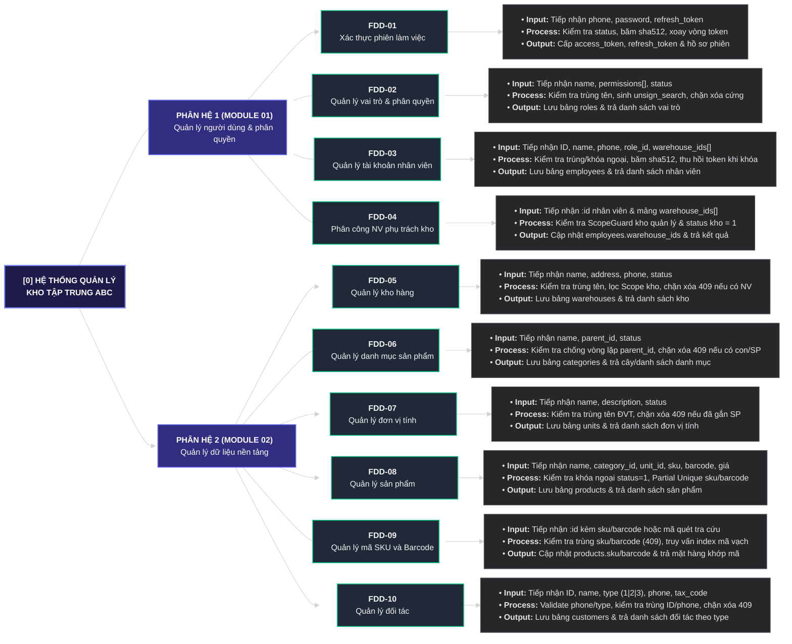

# BƯỚC 4: SƠ ĐỒ PHÂN RÃ CHỨC NĂNG (FDD 3 CẤP) & MA TRẬN PHÂN QUYỀN RBAC

> **Nguồn đầu vào:**
> - [Bước 1 — Khảo sát & Hiểu bài toán (`md/analysis/1-problem-survey.md`)](./1-problem-survey.md)
> - [Bước 2 — Truy vết & Bóc tách Tác nhân (`md/analysis/2-actor-identification.md`)](./2-actor-identification.md)
> - [Bước 3 — Thiết kế Sơ đồ Ngữ cảnh DFD Level 0 (`md/analysis/3-dfd-context-diagram.md`)](./3-dfd-context-diagram.md)
>
> **Quy chuẩn áp dụng:** [`4_fdd_and_rbac_standard.md`](../../.agents/rules/2-analysis/4_fdd_and_rbac_standard.md)

---

## 1. Nguyên tắc Xây dựng FDD & Kiểm chứng Công thức Bảo toàn

### 1.1. Nguyên tắc Thiết kế
1. **Chuyển góc nhìn từ "Ai làm (Who - Bước 3)" sang "Hệ thống có gì (What - Bước 4)":** Mở Hộp đen `Process 0` từ Bước 3 và phân chia chức năng theo **Miền nghiệp vụ / Đối tượng dữ liệu cốt lõi (Core Entity)**, tuyệt đối không lấy tên Actor làm nhánh Cấp 1.
2. **Nguyên tắc MECE (Không trùng lặp - Không bỏ sót):** Mỗi chức năng nghiệp vụ chỉ xuất hiện **duy nhất 1 lần** trên toàn cây FDD. Các hành động trùng nhau giữa nhiều Actor ở Bước 3 được hợp nhất thành 1 chức năng Cấp 2 duy nhất và phân định quyền hạn cụ thể tại **Ma trận RBAC (Mục 4)**.
3. **Cú pháp bắt buộc:** 100% các nút ở mọi cấp (Cấp 1, Cấp 2, Cấp 3) bắt đầu bằng **`Động từ + Danh từ`**.

### 1.2. Kiểm chứng Công thức Bảo toàn Chức năng Cấp 2
Áp dụng công thức bảo toàn từ kết quả của Bước 2 và Bước 3:

$$\text{Tổng Chức năng Cấp 2} = \text{Tổng Hành động Actor (Bước 3)} - \text{Số Hành động trùng giữa các Actor} + \text{Số Tác vụ tự động (Bước 2)}$$

$$\text{Tổng Chức năng Cấp 2} = 33 - 23 + 0 = 10 \text{ (Chức năng Cấp 2)}$$

| Mã FDD | Tên Chức năng Cấp 2 (`Động từ + Danh từ`) | Các Mã Hành động Bước 3 được hợp nhất | Số lượng gốc | Số lượng trùng bị gộp | Số chức năng Cấp 2 |
|:---:|---|---|:---:|:---:|:---:|
| `FDD-01` | **Xác thực phiên làm việc** | `[Admin - 01]`, `[Quản lý kho - 01]`, `[Nhân viên kho - 01]`, `[Kế toán - 01]` | 4 | 3 | **1** |
| `FDD-02` | **Quản lý vai trò và phân quyền** | `[Admin - 02]` | 1 | 0 | **1** |
| `FDD-03` | **Quản lý tài khoản nhân viên** | `[Admin - 03]`, `[Quản lý kho - 02]` | 2 | 1 | **1** |
| `FDD-04` | **Phân công nhân viên phụ trách kho** | `[Admin - 04]`, `[Quản lý kho - 03]` | 2 | 1 | **1** |
| `FDD-05` | **Quản lý kho hàng** | `[Admin - 05]`, `[Quản lý kho - 04]`, `[Nhân viên kho - 02]`, `[Kế toán - 02]` | 4 | 3 | **1** |
| `FDD-06` | **Quản lý danh mục sản phẩm** | `[Admin - 06]`, `[Quản lý kho - 05]`, `[Nhân viên kho - 03]`, `[Kế toán - 03]` | 4 | 3 | **1** |
| `FDD-07` | **Quản lý đơn vị tính** | `[Admin - 07]`, `[Quản lý kho - 06]`, `[Nhân viên kho - 04]`, `[Kế toán - 04]` | 4 | 3 | **1** |
| `FDD-08` | **Quản lý sản phẩm** | `[Admin - 08]`, `[Quản lý kho - 07]`, `[Nhân viên kho - 05]`, `[Kế toán - 05]` | 4 | 3 | **1** |
| `FDD-09` | **Quản lý mã SKU và Barcode** | `[Admin - 09]`, `[Quản lý kho - 08]`, `[Nhân viên kho - 06]`, `[Kế toán - 06]` | 4 | 3 | **1** |
| `FDD-10` | **Quản lý đối tác** | `[Admin - 10]`, `[Quản lý kho - 09]`, `[Nhân viên kho - 07]`, `[Kế toán - 07]` | 4 | 3 | **1** |
| — | **TỔNG CỘNG** | **Toàn bộ 33 hành động từ Bước 3 (+ 0 Tác vụ tự động Bước 2)** | **33** | **23** | **10** |

---

## 2. Sơ đồ Cây Phân rã Chức năng FDD (Cấp 0 ➔ Cấp 1 ➔ Cấp 2 ➔ Cấp 3)

---

## 3. Đặc tả Chi tiết Tác vụ Cấp 3 theo Nhịp IPO (`Input - Process - Output`)

Mỗi chức năng Cấp 2 được bóc tách trực tiếp từ cột `Dữ liệu Input` và `Dữ liệu Output` của **Bảng 5 Cột (Bước 3)** thành 3 nhịp xử lý chuẩn (**Input ➔ Process ➔ Output**), tuân thủ 100% cú pháp `Động từ + Danh từ`:

### 3.1. Phân hệ 1 (Module 01): Quản lý người dùng và phân quyền

| Mã & Tên Chức năng Cấp 2 | Nhịp 1 — Input (`Động từ + Danh từ`) | Nhịp 2 — Process (`Động từ + Danh từ`) | Nhịp 3 — Output (`Động từ + Danh từ`) |
|---|---|---|---|
| **`FDD-01` Xác thực phiên làm việc** | • **Tiếp nhận thông tin đăng nhập:** `phone`, `password`. • **Tiếp nhận yêu cầu làm mới/đăng xuất:** `refresh_token`. • **Tiếp nhận yêu cầu đổi mật khẩu:** `old_password`, `new_password`. | • **Kiểm tra trạng thái tài khoản:** Đối chiếu `status = 1` và mật khẩu băm `sha512`. • **Xử lý xoay vòng Refresh Token (Rotation):** Hủy hiệu lực token cũ (`status = 0`), băm `sha512` token mới. • **Thu hồi phiên đăng nhập:** Vô hiệu hóa toàn bộ `refresh_tokens` khi đăng xuất hoặc đổi mật khẩu. | • **Cấp phát cặp Token mới:** Trả `access_token` (JWT) và `refresh_token`. • **Trả hồ sơ phiên người dùng:** `_id`, `ID`, `name`, `phone`, `role`, `warehouse_ids[]` (ẩn `password`). |
| **`FDD-02` Quản lý vai trò và phân quyền** | • **Tiếp nhận thông tin vai trò:** `name`, `description`, `permissions[]` (`<resource>.<action>`). • **Tiếp nhận trạng thái khóa/mở:** `status` (`0` \| `1`). • **Tiếp nhận tham số lọc:** `page`, `limit`, `keyword`, `status`. | • **Kiểm tra trùng tên vai trò:** Đảm bảo `name` là duy nhất (`409 CONFLICT` nếu trùng). • **Chuẩn hóa dữ liệu tìm kiếm:** Tự động sinh chuỗi `unsign_search` từ `name` (cả có dấu và không dấu chữ thường). • **Bảo vệ toàn vẹn vai trò:** Chặn xóa cứng tuyệt đối đối với bảng `roles`. | • **Lưu trữ bản ghi vai trò:** Ghi nhận vào bảng `roles` và trả về object vai trò kèm `permissions[]`. • **Trả danh sách vai trò phân trang:** Trả `items[]` và `pagination`. |
| **`FDD-03` Quản lý tài khoản nhân viên** | • **Tiếp nhận hồ sơ nhân viên:** `ID` (Mã NV), `name`, `phone`, `email`, `address`, `password`, `role_id`, `warehouse_ids[]`. • **Tiếp nhận yêu cầu cập nhật đặc thù:** Đổi `role_id`, đặt lại `new_password`, đổi `status` (`0` \| `1`). • **Tiếp nhận tiêu chí tra cứu:** `page`, `limit`, `keyword`, `status`, `roleId`, `warehouseId`, `fromDate`, `toDate`. | • **Kiểm tra tính duy nhất & khóa ngoại:** Kiểm tra trùng `ID`, `phone`, `email` (`409`); kiểm tra `role_id` và `warehouse_ids[]` tồn tại, đang hoạt động (`status = 1`, sai trả `404`). • **Mã hóa & chuẩn hóa chuỗi:** Băm `password` bằng `sha512`; sinh `unsign_search` từ `ID`, `name`, `phone`, `email`. • **Kiểm soát khóa tài khoản & Scope:** Chặn tự khóa chính mình (`403`); thu hồi toàn bộ `refresh_tokens` khi khóa tài khoản (`status = 0`) hoặc đặt lại mật khẩu; giới hạn kết quả theo kho quản lý với `Warehouse Manager`. | • **Lưu trữ hồ sơ nhân viên:** Cập nhật bảng `employees` (tuyệt đối ẩn `password`, `unsign_search`). • **Trả danh sách & chi tiết nhân viên:** Populate thông tin rút gọn của `role` và `warehouses[]` kèm `pagination`. |
| **`FDD-04` Phân công nhân viên phụ trách kho** | • **Tiếp nhận yêu cầu phân công kho:** ID nhân viên (`:id`) và mảng `warehouse_ids[]` (`ObjectId[]`) cần gán hoặc hủy gán. | • **Kiểm tra phạm vi quyền hạn (`ScopeGuard`):** Nếu người gọi là `Admin` ➔ cho phép gán/hủy gán mọi kho; nếu là `Warehouse Manager` ➔ kiểm tra các kho thao tác phải nằm trong `warehouse_ids[]` mà Manager đó đang quản lý (ngoài phạm vi trả `403 FORBIDDEN`). • **Kiểm tra hiệu lực kho hàng:** Đảm bảo mọi phần tử trong `warehouse_ids[]` đều tồn tại và có `status = 1` (`404 NOT_FOUND` nếu sai). | • **Cập nhật phạm vi kho phụ trách:** Ghi nhận mảng `warehouse_ids[]` mới vào bản ghi nhân viên trong bảng `employees`. • **Trả kết quả phân công kho:** Trả `_id` nhân viên kèm danh sách `warehouse_ids[]` và thông tin các kho sau khi cập nhật. |

---

### 3.2. Phân hệ 2 (Module 02): Quản lý dữ liệu nền tảng

| Mã & Tên Chức năng Cấp 2 | Nhịp 1 — Input (`Động từ + Danh từ`) | Nhịp 2 — Process (`Động từ + Danh từ`) | Nhịp 3 — Output (`Động từ + Danh từ`) |
|---|---|---|---|
| **`FDD-05` Quản lý kho hàng** | • **Tiếp nhận thông tin kho hàng:** `name` (Tên kho), `address`, `phone`, `description`, `status` (`0` \| `1`). • **Tiếp nhận tiêu chí tra cứu / xóa:** `:id`, `page`, `limit`, `keyword`, `status`, `fromDate`, `toDate`. | • **Kiểm tra trùng tên kho & phân lọc theo Scope:** Kiểm tra trùng `name` (`409`); lọc danh sách kho theo `warehouse_ids[]` đối với `Warehouse Manager` và `Warehouse Staff`. • **Sinh chuỗi tìm kiếm tiếng Việt:** Tạo `unsign_search` từ `name`, `address`, `phone`. • **Kiểm tra ràng buộc trước khi xóa cứng (`DELETE`):** Kiểm tra xem kho có đang được tham chiếu trong `employees.warehouse_ids` hay không; nếu đã có tham chiếu ➔ chặn xóa `409 CONFLICT` và yêu cầu khóa mềm (`status = 0`). | • **Lưu trữ bản ghi kho hàng:** Ghi nhận vào bảng `warehouses`. • **Trả danh sách / chi tiết kho hàng:** Trả thông tin kho kèm `pagination` hoặc thông báo xóa thành công. |
| **`FDD-06` Quản lý danh mục sản phẩm** | • **Tiếp nhận thông tin danh mục:** `name`, `parent_id` (`null` hoặc `ObjectId`), `description`, `status` (`0` \| `1`). • **Tiếp nhận tiêu chí tra cứu / xóa:** `:id`, xem cây `/tree`, `page`, `limit`, `keyword`, `status`, `parentId`, `fromDate`, `toDate`. | • **Kiểm tra phân cấp Cha - Con & chống vòng lặp:** Kiểm tra `parent_id` tồn tại và `status = 1` (`404`); khi cập nhật, kiểm tra chống trỏ vòng lặp vào chính nó hoặc danh mục con của nó (`400 VALIDATION_ERROR`). • **Sinh chuỗi tìm kiếm & dựng cây:** Tự sinh `unsign_search` từ `name`; đệ quy/tổng hợp cấu trúc cây danh mục. • **Kiểm tra toàn vẹn khi xóa (`DELETE`):** Chặn xóa `409 CONFLICT` nếu danh mục đang có danh mục con (`categories.parent_id`) hoặc đã gắn sản phẩm (`products.category_id`). | • **Lưu trữ bản ghi danh mục:** Ghi nhận vào bảng `categories`. • **Trả cây danh mục hoặc danh sách phân trang:** Trả mảng cây `children[]` hoặc `items[]` kèm `pagination`. |
| **`FDD-07` Quản lý đơn vị tính** | • **Tiếp nhận thông tin đơn vị tính:** `name` (Tên ĐVT), `description`, `status` (`0` \| `1`). • **Tiếp nhận tiêu chí tra cứu / xóa:** `:id`, `page`, `limit`, `keyword`, `status`, `fromDate`, `toDate`. | • **Kiểm tra trùng tên đơn vị tính:** Đảm bảo `name` duy nhất (`409 CONFLICT` nếu trùng). • **Sinh chuỗi tìm kiếm:** Tạo `unsign_search` từ `name`. • **Kiểm tra toàn vẹn khi xóa (`DELETE`):** Chặn xóa `409 CONFLICT` nếu đơn vị tính đã được tham chiếu bởi bất kỳ sản phẩm nào (`products.unit_id`). | • **Lưu trữ bản ghi đơn vị tính:** Ghi nhận vào bảng `units`. • **Trả danh sách / chi tiết đơn vị tính:** Trả `items[]` kèm `pagination` hoặc kết quả xóa. |
| **`FDD-08` Quản lý sản phẩm** | • **Tiếp nhận thông tin sản phẩm:** `name`, `category_id`, `unit_id`, `sku`, `barcode`, `import_price`, `export_price`, `description`, `status` (`0` \| `1`). • **Tiếp nhận tiêu chí tra cứu / xóa:** `:id`, `page`, `limit`, `keyword`, `status`, `categoryId`, `unitId`, `fromDate`, `toDate`. | • **Kiểm tra khóa ngoại & giá trị số:** Kiểm tra `category_id` và `unit_id` tồn tại, đang hoạt động (`status = 1`, sai trả `404`); kiểm tra `import_price >= 0`, `export_price >= 0`. • **Kiểm tra Partial Unique Index:** Đảm bảo `sku` và `barcode` (nếu truyền vào khác `null`) không trùng với sản phẩm khác (`409 CONFLICT`). • **Sinh chuỗi tìm kiếm:** Tạo `unsign_search` từ `name`, `sku`, `barcode`. | • **Lưu trữ bản ghi sản phẩm:** Ghi nhận vào bảng `products`. • **Trả danh sách / chi tiết sản phẩm:** Populate thông tin rút gọn `category` (`_id`, `name`) và `unit` (`_id`, `name`) kèm `pagination`. |
| **`FDD-09` Quản lý mã SKU và Barcode** | • **Tiếp nhận định danh mã sản phẩm:** `:id` sản phẩm kèm `sku`, `barcode` cần gán/cập nhật. • **Tiếp nhận mã quét tra cứu nhanh:** Chuỗi `sku` hoặc `barcode` từ máy quét / ô tìm kiếm. | • **Kiểm tra tính duy nhất của SKU & Barcode:** Kiểm tra `sku` và `barcode` không bị trùng lặp trên toàn hệ thống (`409 CONFLICT`), đồng thời cập nhật lại `unsign_search` của sản phẩm. • **Đối chiếu chính xác theo mã:** Truy vấn index trên trường `sku` và `barcode` để trả kết quả tức thì khi nhân viên quét mã vạch. | • **Cập nhật định danh trên bảng sản phẩm:** Lưu `sku`, `barcode` mới vào bản ghi `products`. • **Trả thông tin mặt hàng theo mã:** Trả chi tiết sản phẩm khớp với `sku` hoặc `barcode` (`404 NOT_FOUND` nếu không tồn tại). |
| **`FDD-10` Quản lý đối tác** | • **Tiếp nhận hồ sơ đối tác:** `ID` (Mã đối tác), `name`, `type` (`1` Khách hàng \| `2` Nhà cung cấp \| `3` Khách thợ), `phone`, `email`, `address`, `tax_code`, `note`, `status` (`0` \| `1`). • **Tiếp nhận tiêu chí tra cứu / xóa:** `:id`, `page`, `limit`, `keyword`, `type`, `status`, `fromDate`, `toDate`. | • **Kiểm tra trùng lặp & định dạng:** Validate định dạng `phone`, `email`, `type` thuộc `1 | 2 | 3`; kiểm tra trùng `ID` và `phone` (`409 CONFLICT`). • **Sinh chuỗi tìm kiếm tiếng Việt:** Tạo `unsign_search` kết hợp từ `ID`, `name`, `phone`, `email`, `tax_code`. • **Kiểm tra điều kiện xóa (`DELETE`):** Cho phép xóa nếu chưa phát sinh dữ liệu giao dịch tham chiếu; nếu đã có tham chiếu trả `409 CONFLICT`. | • **Lưu trữ hồ sơ đối tác hợp nhất:** Ghi nhận vào bảng `customers` với trường phân loại `type`. • **Trả danh sách / chi tiết đối tác:** Trả danh sách lọc theo `type` (`Khách hàng` / `Nhà cung cấp` / `Khách thợ`) kèm `pagination`. |

---

## 4. Ma trận Truy vết Phân quyền RBAC & Phân tách Trách nhiệm (SoD)

Bảng dưới đây kết nối xuyên suốt từ **Bước 2 (Actor)** & **Bước 3 (Mã hành động DFD)** sang **Bước 4 (Mã FDD)**, **Bước 5 (Bảng Database dự kiến)** và **Bước 6 (Quyền hạn RBAC trên API)**:

| STT | Mã FDD | Tên chức năng Cấp 2 | Nguồn Hành động / Tác vụ (Bước 2 & 3) | Bảng DB dự kiến (Bước 5) | `Admin` | `Warehouse Manager` | `Warehouse Staff` | `Accountant` |
|:---:|:---:|---|---|---|---|---|---|---|
| **1** | `FDD-01` | **Xác thực phiên làm việc** | `[Admin - 01]`, `[Quản lý kho - 01]`, `[Nhân viên kho - 01]`, `[Kế toán - 01]` | `employees`, `refresh_tokens` | `Authenticated` *(Login / Refresh / Logout / Đổi MK)* | `Authenticated` *(Login / Refresh / Logout / Đổi MK)* | `Authenticated` *(Login / Refresh / Logout / Đổi MK)* | `Authenticated` *(Login / Refresh / Logout / Đổi MK)* |
| **2** | `FDD-02` | **Quản lý vai trò và phân quyền** | `[Admin - 02]` | `roles` *(Không có API xóa cứng)* | `roles.read` `roles.write` | ❌ Không có quyền | ❌ Không có quyền | ❌ Không có quyền |
| **3** | `FDD-03` | **Quản lý tài khoản nhân viên** | `[Admin - 03]`, `[Quản lý kho - 02]` | `employees` *(Không có API xóa cứng)* | `employees.read` `employees.write` *(Toàn hệ thống)* | `employees.read` *(Chỉ trong Scope kho mình quản lý)* | ❌ Không có quyền | ❌ Không có quyền |
| **4** | `FDD-04` | **Phân công nhân viên phụ trách kho** | `[Admin - 04]`, `[Quản lý kho - 03]` | `employees.warehouse_ids` *(Mảng nhúng trong `employees`)* | `employees.write` *(Gán/hủy gán mọi kho)* | `employees.write` + `ScopeGuard` *(Chỉ gán/hủy gán kho mình quản lý)* | ❌ Không có quyền | ❌ Không có quyền |
| **5** | `FDD-05` | **Quản lý kho hàng** | `[Admin - 05]`, `[Quản lý kho - 04]`, `[Nhân viên kho - 02]`, `[Kế toán - 02]` | `warehouses` | `warehouses.read` `warehouses.write` `warehouses.delete` | `warehouses.read` *(Scope kho quản lý)* | `warehouses.read` *(Scope kho phụ trách)* | `warehouses.read` *(Toàn hệ thống)* |
| **6** | `FDD-06` | **Quản lý danh mục sản phẩm** | `[Admin - 06]`, `[Quản lý kho - 05]`, `[Nhân viên kho - 03]`, `[Kế toán - 03]` | `categories` *(Đa cấp `parent_id`)* | `categories.read` `categories.write` `categories.delete` | `categories.read` `categories.write` | `categories.read` | `categories.read` |
| **7** | `FDD-07` | **Quản lý đơn vị tính** | `[Admin - 07]`, `[Quản lý kho - 06]`, `[Nhân viên kho - 04]`, `[Kế toán - 04]` | `units` | `units.read` `units.write` `units.delete` | `units.read` `units.write` | `units.read` | `units.read` |
| **8** | `FDD-08` | **Quản lý sản phẩm** | `[Admin - 08]`, `[Quản lý kho - 07]`, `[Nhân viên kho - 05]`, `[Kế toán - 05]` | `products` | `products.read` `products.write` `products.delete` | `products.read` `products.write` | `products.read` | `products.read` |
| **9** | `FDD-09` | **Quản lý mã SKU và Barcode** | `[Admin - 09]`, `[Quản lý kho - 08]`, `[Nhân viên kho - 06]`, `[Kế toán - 06]` | `products.sku`, `products.barcode` *(Thuộc tính trong `products`)* | `products.read` `products.write` | `products.read` `products.write` | `products.read` | `products.read` |
| **10** | `FDD-10` | **Quản lý đối tác** | `[Admin - 10]`, `[Quản lý kho - 09]`, `[Nhân viên kho - 07]`, `[Kế toán - 07]` | `customers` (`type = 1 \| 2 \| 3`) | `customers.read` `customers.write` `customers.delete` | `customers.read` `customers.write` | `customers.read` | `customers.read` |

---

### Nguyên tắc Phân tách Trách nhiệm (Separation of Duties — SoD) đã áp dụng:
1. **Tách biệt Quản trị Hệ thống (`Admin`) và Quản lý Vận hành Kho (`Warehouse Manager`):**
   - Chỉ `Admin` mới có quyền cấu hình vai trò (`roles.write`), tạo/sửa/khóa tài khoản nhân viên, tạo/sửa/xóa Kho hàng (`warehouses.write`, `warehouses.delete`) và thực hiện xóa cứng (`*.delete`) dữ liệu nền tảng khi chưa có tham chiếu.
   - `Warehouse Manager` được trao quyền chủ động phân công nhân sự (`FDD-04`) **nhưng bị khóa chặt bởi `ScopeGuard` chỉ trong phạm vi các kho mà mình đang quản lý**, đồng thời được phép thêm/cập nhật (`write`) danh mục hàng hóa & đối tác để phục vụ vận hành kho hàng ngày.
2. **Tách biệt Tác nghiệp Kho (`Warehouse Staff`) và Giám sát / Đối soát Kế toán (`Accountant`):**
   - `Warehouse Staff` chỉ xem được thông tin kho mình được gán phụ trách (`warehouse_ids[]`) và tra cứu danh mục hàng hóa, `SKU`/`Barcode`, đối tác; tuyệt đối không được tự ý sửa đổi dữ liệu danh mục hay giá sản phẩm.
   - `Accountant` có quyền tra cứu (`read`) toàn bộ 3 kho hàng, sản phẩm và đối tác trên toàn hệ thống để đối soát độc lập, nhưng không có quyền chỉnh sửa (`write`/`delete`) bất kỳ dữ liệu vận hành nào.

