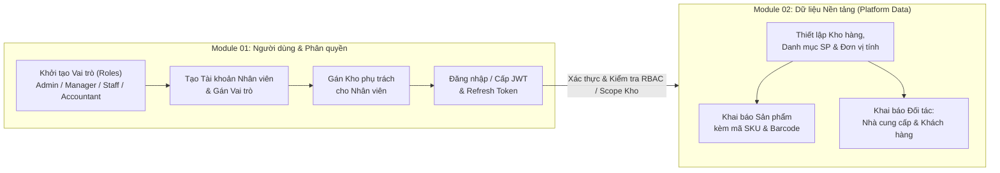

# BƯỚC 0: ĐỀ BÀI & YÊU CẦU GỐC — HỆ THỐNG QUẢN LÝ KHO TẬP TRUNG (CÔNG TY ABC)

## 1. Bối cảnh Nghiệp vụ & Nỗi đau Thực tế (Business Context & Pain Points)

**Công ty ABC** chuyên kinh doanh thiết bị điện tử, linh kiện máy tính và phụ kiện công nghệ.

Hiện tại công ty có **3 kho hàng** tại các địa điểm khác nhau. Việc quản lý nhập hàng, xuất hàng và kiểm kê đang được thực hiện thủ công bằng **Excel**, dẫn đến các vấn đề (Pain Points):
1. **Không kiểm soát được số lượng hàng tồn thực tế** tại từng kho.
2. **Không biết nhân viên nào** thực hiện thao tác nhập hoặc xuất hàng (thiếu định danh và truy vết trách nhiệm).
3. **Dễ xảy ra tình trạng xuất hàng vượt quá số lượng tồn kho** thực tế.
4. **Khó theo dõi lịch sử biến động hàng hóa** qua các kỳ.
5. **Không kiểm soát được hàng hóa đang vận chuyển** điều chuyển giữa các kho.
6. **Khó tổng hợp báo cáo nhập - xuất - tồn** theo thời gian một cách nhanh chóng và chính xác.

---

## 2. Mục tiêu Cốt lõi & Phạm vi Triển khai (System Objectives & Scope)

- **Quyết định từ Ban lãnh đạo:** Xây dựng một **Hệ thống Quản lý Kho tập trung** bằng **API NestJS** (kết nối cơ sở dữ liệu tập trung) để chuẩn hóa dữ liệu, định danh người dùng, phân quyền chặt chẽ theo vai trò/kho phụ trách và làm nền tảng cho các nghiệp vụ nhập - xuất - điều chuyển - kiểm kê.
- **Phạm vi thực hiện hiện tại (Phase 1 — Core Foundation):** Tập trung xây dựng trước **2 Module nền tảng cơ bản** (`Module 01` và `Module 02`) nhằm thiết lập khung xác thực, phân quyền nhân sự theo kho và chuẩn hóa toàn bộ hệ thống Dữ liệu nền tảng.

---

## 3. Yêu cầu Chức năng Chi tiết theo Module

### 3.1. Module 01 — Quản lý Người dùng và Phân quyền (Users & RBAC)

#### a) Chức năng yêu cầu
- **Xác thực phiên làm việc:** Đăng nhập (`Login`), Đăng xuất (`Logout`), Làm mới phiên (`Refresh Token`).
- **Quản lý tài khoản nhân viên:** Tạo mới, xem danh sách/chi tiết, cập nhật thông tin, khóa/mở khóa tài khoản nhân viên.
- **Phân quyền theo vai trò (RBAC):** Quản lý vai trò và gán quyền hạn tương ứng cho từng tài khoản.
- **Gán nhân viên phụ trách kho:** Phân công nhân viên chịu trách nhiệm quản lý/tác nghiệp tại một hoặc nhiều kho hàng cụ thể (trong hệ thống 3 kho của công ty).

#### b) Các vai trò trong hệ thống (System Roles)
| STT | Tên vai trò (Role) | Mô tả quyền hạn & Trách nhiệm cốt lõi |
|:---:|---|---|
| 1 | **Admin** | Toàn quyền quản trị hệ thống (quản lý nhân viên, phân quyền, dữ liệu nền tảng, cấu hình kho). |
| 2 | **Warehouse Manager** | Quản lý kho (quản lý hoạt động và dữ liệu trong phạm vi kho được phân công). |
| 3 | **Warehouse Staff** | Nhân viên kho (thao tác nghiệp vụ hàng ngày tại kho được gán phụ trách). |
| 4 | **Accountant** | Kế toán (tra cứu dữ liệu danh mục, đối tác và xem báo cáo tổng hợp). |

---

### 3.2. Module 02 — Quản lý Dữ liệu Nền tảng (Platform Data Management)

#### Chức năng yêu cầu
1. **CRUD Kho hàng (`Warehouses`):** Quản lý thông tin các kho hàng của công ty (hiện có 3 kho tại các địa điểm khác nhau).
2. **CRUD Danh mục sản phẩm (`Categories`):** Quản lý phân loại nhóm thiết bị điện tử, linh kiện máy tính, phụ kiện công nghệ.
3. **CRUD Đơn vị tính (`Units`):** Quản lý đơn vị đo lường của hàng hóa (cái, chiếc, bộ, hộp, thanh...).
4. **CRUD Sản phẩm (`Products` / `Subcategories`):** Quản lý thông tin hàng hóa gắn với danh mục, đơn vị tính và các thuộc tính kỹ thuật/giá.
5. **Quản lý mã `SKU` và `Barcode`:** Định danh duy nhất cho từng mặt hàng phục vụ tra cứu nhanh và quét mã vạch khi tác nghiệp kho.
6. **CRUD Nhà cung cấp (`Suppliers`):** Quản lý thông tin đối tác cung ứng hàng hóa đầu vào.
7. **CRUD Khách hàng (`Customers`):** Quản lý thông tin khách hàng mua sản phẩm đầu ra.

---

## 4. Luồng Nghiệp vụ Tổng thể của 2 Module Nền tảng (End-to-End Pipeline)

